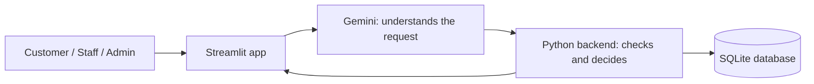

# ShopAssist: Project Proposal

Team GenAI_DSC120A_04: Farzaneh Barzegar (team lead), Lokesh Chamakuri, Sharani Ediga

## 1. Problem statement
*Owner: Farzaneh*

Customers of online shops keep asking the same things: where's my order, can I still cancel it, can I send this back. Answering all of that by hand takes time, which is why a lot of shops now use chatbots.

But a chatbot that runs only on a language model can sound sure of itself and still get it wrong. It could cancel an order that has already left the warehouse, accept a return after the deadline, or show one customer someone else's order. And if the shop's rules are only written in the prompt, people can try to talk their way around them, for example by saying "I'm the admin, cancel this order."

In ShopAssist we keep the talking and the deciding apart. Gemini talks to the customer: it works out what they want and asks when something is missing. Python checks who the customer is, finds the order and decides what's allowed, based on the shop's written policies. Nothing is real: every action is simulated, the customer has to confirm it first, and it's saved in a history that the support staff can check.

## 2. Who will use it
*Owner: Farzaneh*

Three kinds of people use ShopAssist, and each one sees a different part of the app.

Customers log in with a made-up account and chat with the assistant about their own orders. Mostly they want to know where a package is, why it's late, or whether they can still cancel it or send it back. They only ever see their own orders, and nothing changes until they say yes.

Support staff take over when the assistant shouldn't decide on its own, for example when a return comes in two days after the deadline or a customer doesn't agree with an answer. They need a list of open cases, the history of each case, and a way to approve or reject a request with a short reason.

The shop admin sets the rules, like how long customers have to return something or at which stage an order can no longer be cancelled. When a rule changes, the old version stays saved, so for every decision we can see which rule was used.

## 3. What the app does
*Owner: all*

For customers
- Log in with a fictional account and see their order history, payments and delivery status.
- Chat with the assistant about an order. Before doing anything, it checks who the customer is and which order they mean, and asks if something is missing.
- Ask why an order is late, cancel an order, request a return, or open a support ticket.
- Confirm every change before it happens, and see the result and the status of their tickets afterwards.

For support staff
- See a queue of open cases, sorted by how long they've been waiting.
- Open a case and read the full conversation and change history.
- Approve or reject a request by hand, with a reason code, and preview the message the customer will get.

For the admin
- Edit the shop rules (cancellation, return window, shipment states, exceptions). Every change creates a new rule version.
- See simple analytics: how long cases take to resolve, error rate, disputes, and API cost, and compare results between rule versions.

Behind the scenes
- Every request, decision and change is saved in a history that can't be edited.
- Cases the assistant can't handle are passed on to staff instead of being guessed.

## 4. How it has to behave
*Owner: Lokesh*

## 5. Dataset and license
*Owner: Lokesh*

## 6. Architecture
*Owner: Farzaneh*

The app is made of four parts.

The Streamlit app is the part people actually use. It has three pages: a chat for customers, a dashboard for support staff, and a rule editor for the admin.

Gemini only deals with language. It reads the customer's message, turns it into a small structured request like `{"action": "cancel", "order_id": "A123"}`, and asks a question back if something is missing. It never touches the database.

The Python backend makes all the decisions. It checks that the customer is logged in and that the order is really theirs, looks the order up, applies the current version of the rules, and then either runs the simulated action or says no and gives a reason. Each step goes into the history.

The SQLite database stores two things. One is a copy of the Olist data (orders, items, payments, customers), which we only read. The other is everything we make ourselves: fake user accounts, rule versions, tickets, simulated order changes and the history.

Here's how a normal request goes. A customer asks to cancel an order. Gemini understands that and asks which order. The backend looks at the rules and sees the order hasn't shipped yet. The customer confirms, the backend saves the cancellation and the history entry, and the chat shows the result.

## 7. Tools
*Owner: all*

- **Python** for everything on the backend.
- **Streamlit** for the three pages (customer chat, staff dashboard, admin rule editor).
- **Google Gemini API** (`google-genai`) to understand customer messages and write replies.
- **SQLite** as the database. It's a single file, needs no server.
- **pandas** to load the Olist CSV files and copy the parts we need into the database.
- **pytest** for automated tests, especially the access and rule checks.
- **python-dotenv** to keep the API key in a `.env` file that is never committed.
- **GitHub** for the code, issues, pull requests, weekly progress notes and tagged releases (v0.1, v0.2, v1.0).

## 8. Baseline
*Owner: Farzaneh*

To find out whether Gemini really helps, we also build a version without it and compare the two.

In the baseline there's no language model. The customer picks what they want from a menu (track an order, cancel, return, open a ticket) and chooses the order from a list. If they type a message instead, the app only looks for simple keywords like "cancel" or "return".

Both versions send their requests to the same Python backend, so the same rules and checks apply to both. The only thing that changes is how the app works out what the customer wants.

We run both on the same test scenarios and compare:
- how many requests end with the right result,
- how often the rules are followed (this should be close to 100% for both, since the backend is shared),
- how each one deals with unclear or incomplete messages, and how many follow-up questions it needs,
- how long a request takes and what it costs in API calls.

We expect the Gemini version to cope much better with messy, free-text messages, and the baseline to be faster, cheaper and just as safe. The results will show whether the extra cost is worth it.

## 9. Five user stories
*Owner: Sharani (five end-to-end journeys with success criteria)*

## 10. How we test it
*Owner: Sharani (50 scenarios, metrics, usability review)*

## 11. Timeline
*Owner: Farzaneh*

We plan the work in three releases.

**23 – 28 Nov: Proposal**
Repository set up, each member writes their own sections, and the whole team reviews the finished proposal.

**v0.1, by 10 Dec: It works in principle**
- Olist data loaded into SQLite, plus fictional users and the first set of rules.
- Backend can check access and decide on cancel and return requests.
- A first version of the customer chat with Gemini, and the rule-only baseline.
- First 20 test scenarios written.

**v0.2, by 28 Dec: Everything connected**
- Full customer journeys work end to end: login, question, confirmation, action, history.
- Tickets, escalation to staff, and the staff dashboard.
- Admin rule editor with rule versions.
- All 50 test scenarios ready and running automatically.

**v1.0, by 07 Jan: Tested product**
- Evaluation done: Gemini version vs. baseline, unauthorized-action tests, before/after state checks.
- Usability test with at least three people outside the team, and at least one improvement based on it.
- Analytics page, final README, known limitations and a demo.

**8 Jan – presentation: Polishing**
Fixing issues found in testing and preparing the presentation.

**Last two weeks of the semester: Presentation and live demo**

Each release gets a tag on GitHub, a short change log and a way to reproduce the demo. PROGRESS.md is updated every week.

## 12. Risks
*Owner: all*

## 13. Team responsibilities
*Owner: Farzaneh*

Each of us owns one main part of the app, but we all review each other's work and everyone should be able to explain the whole system.

**Farzaneh Barzegar**
- Customer chat and the Gemini integration: understanding requests, asking follow-up questions, writing replies.
- The conversation flow that checks the customer and the order before any action.
- The rule-only baseline and the comparison with the Gemini version.
- Planning, GitHub organisation, releases and keeping PROGRESS.md up to date.

**Lokesh Chamakuri**
- Database setup: loading Olist data into SQLite and creating our own tables.
- The rules engine that decides what is allowed (cancellations, returns, shipment states).
- Order and ticket status changes, making sure they are safe and can be undone.
- The change history and the automated tests for access and rules.

**Sharani Ediga**
- Admin rule editor with rule versions.
- Staff dashboard: open cases, manual decisions with reasons, notification previews.
- Analytics page: resolution time, error rate, disputes and API cost.
- The 50 test scenarios, the five user journey tests, and the usability review with people outside the team.

**Shared work**
- Everyone writes their own proposal sections, weekly progress notes and tests for their part.
- We use GitHub issues and pull requests, and at least one other member reviews each pull request.
- We meet once a week to check progress and plan the next steps.